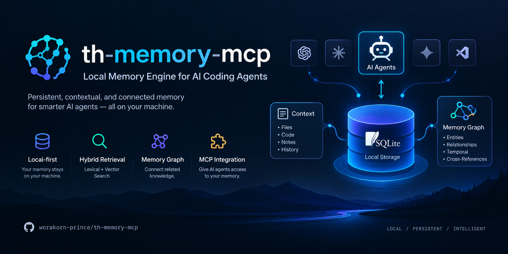

<div align="center">
  
</div>

# th-memory-mcp

<div align="center">

[](https://www.npmjs.com/package/th-memory-mcp) [](https://www.npmjs.com/package/th-memory-mcp) [](LICENSE) [](https://nodejs.org) [](https://github.com/worakorn-prince/th-memory-mcp/actions/workflows/ci.yml) [](https://github.com/worakorn-prince/th-memory-mcp/actions/workflows/version-sync.yml)

[](https://mcpservers.org/servers/worakorn-prince/th-memory-mcp) [](https://glama.ai/mcp/servers/worakorn-prince/th-memory-mcp) [](https://mcprush.com/to/th-memory-mcp?ref=badge)

</div>

## Requirements

- **Node.js 22.23.4+, 24.22.1+, or 26.12.1+** — patched releases only; the server uses Node-only APIs (`better-sqlite3` native build, `import.meta.url`). Node.js 20 is EOL and unsupported. CI tests the minimum patched version of each supported line (22/24/26).
- **npm** — for `npm install`, `npm run build`, `npm test`. No external services, accounts, or API keys — everything lives in a single local SQLite file.
- **OpenCode** — the host that loads the MCP server and the auto-capture plugin (any build with MCP over stdio + plugins). The plugin uses `node:sqlite` on OpenCode Desktop/Node 22.5+ and falls back to `bun:sqlite` on the Bun-based CLI.
- **OS: Windows / macOS / Linux** — cross-platform (Node); Windows: set `MEMORY_DB_PATH` with `setx`, macOS/Linux: `export` in your shell profile.

> **Security:** Use a patched Node.js release — check your runtime with `npx is-my-node-vulnerable`. `npm audit` covers npm dependencies only, not Node.js core CVEs.

## Quick Start

**Fastest path:** `npm run quickstart` (after cloning) builds, wires `opencode.json`/`opencode.jsonc`, deploys the plugin, and sets `MEMORY_DB_PATH` — the steps below are the manual equivalent. **npm alternative:** `npm install -g th-memory-mcp` (or `npx th-memory-mcp`) and point `mcp.command` to `th-memory-mcp` instead of `dist/index.js` (plugin still from this repo; not on GitHub Packages anymore).

```bash
# 1. Clone and build
git clone https://github.com/worakorn-prince/th-memory-mcp.git
cd th-memory-mcp && npm install && npm run build
# 2. Share one DB between the server and the plugin
setx MEMORY_DB_PATH "$PWD/data/memory.db"      # Windows (PowerShell)
# export MEMORY_DB_PATH="$PWD/data/memory.db"  # macOS/Linux — add to your shell profile (~/.zshrc)
```

3. Merge this into `~/.config/opencode/opencode.json` (replace `<REPO>` with the absolute clone path; ready-made block in [`opencode.example.json`](opencode.example.json)). `MEMORY_DB_PATH` must be the SAME file for server and plugin — a system/user-level env var covers both; `environment` below covers the server only. Example rules: [`AGENTS.memory.example.md`](AGENTS.memory.example.md) (attachable at project level).

```json
{ "instructions": ["<REPO>/AGENTS.memory.example.md"],
  "mcp": { "memory": { "type": "local", "command": ["node", "<REPO>/dist/index.js"], "enabled": true, "environment": { "MEMORY_DB_PATH": "<REPO>/data/memory.db" } } } }
```

4. (Optional) Auto-capture: deploy the dual-mode plugin to a **directory** (OpenCode V2 only auto-discovers local plugins from a folder) — `src/plugin/learning-capture.ts` → `~/.config/opencode/plugins/learning-capture/index.ts`
5. **Restart OpenCode** (config loads at startup only), then try: *"Remember that I prefer pnpm"* → new session → *"What package manager do I prefer?"*

The plugin works in both modes: OpenCode V2 calls the default export's `id` + `setup(ctx)` (domain hooks for prompt/tool/compaction/failure events), while V1 (1.18.29+) calls the same default export's `server()`, which returns the legacy hook object. One file, no runtime import of `@opencode/plugin` (types only), so it loads under both Node and Bun.

If startup reports `Failed to load plugin ... Received protocol 'bun:'` or the plugin is silently ignored on V2, you are on an older install layout. Re-deploy the current `src/plugin/learning-capture.ts` to `~/.config/opencode/plugins/learning-capture/index.ts`; a legacy `~/.config/opencode/plugins/learning-capture.ts` is renamed to `.bak-<timestamp>` by `npm run quickstart` (never deleted). It loads `node:sqlite` first and only falls back to `bun:sqlite` under Bun.

## Architecture

OpenCode loads the plugin `learning-capture` (dual-mode V1/V2, Node/Bun) — auto-captures prompt/tool/error into the DB, injects the profile on compaction — and the MCP server `th-memory-mcp` (Node stdio) exposing the 16 tools on that same SQLite DB; global rules (`memory-protocol.md`) teach the AI to use them.

## Why th-memory-mcp?

- **Context-based learning, not fine-tuning** — captures your preferences, corrections, and habits, then recalls them next session; no data leaves your machine.
- **100% local & private** — one SQLite file, no cloud, no external API; secrets (`api_key=`, `password:`, `token`) filtered before storage.
- **Low overhead & resilient** — tool calls are capped (latency < 10 ms, bounded output) and degrade gracefully if the DB is unavailable.
- **Open & extensible** — MIT licensed; 16 documented tools, rule-based distill, auto-capture plugin; Node + `better-sqlite3` only (no extra native extensions).

## Highlights

- **Structured memory** — preferences with confidence scoring plus `lesson` records (situation → mistake → correction), not just flat facts.
- **Lifecycle, temporal & conflict-aware** — states (active/stale/superseded/archived), confidence/importance/salience scoring, per-type decay, validity intervals for point-in-time truth and supersession chains; duplicate/contradiction resolution keeps both sides of ambiguous evidence.
- **Hybrid retrieval** — `get_context` blends FTS5 keyword search with dependency-free lexical fuzzy matching (hashed n-gram similarity, 512-dim FNV-1a) via RRF fusion, then assembles a token-budgeted context with optional memory-graph expansion.
- **Consolidation** — clusters similar memories into derived ones with full provenance (`derived_from` links).
- **First-class Thai / i18n** — Thai-aware tokenization in distill; Thai and English accepted interchangeably.

## Works with other harnesses

A standard MCP server: 16 tools anywhere MCP-over-stdio works; all harnesses share one SQLite file via `MEMORY_DB_PATH`. Auto-capture needs a hook runtime (built into OpenCode, bridged for Claude Code).

| Feature | OpenCode | Claude Code | Qwen Code | Codex | Cursor |
|---|---|---|---|---|---|
| 16 MCP tools | ✅ | ✅ | ✅ | ✅ | ✅ |
| Auto-capture (background) | ✅ plugin | ✅ [hooks](CLAUDE_CODE_HOOKS.md) | ⚠️ adapter | ❌ manual | ❌ Rules |
| Profile injection | ✅ compaction | ✅ UserPromptSubmit | ❌ `get_profile` | ❌ `get_profile` | ❌ `get_profile` |
| Lexical fuzzy matching | ✅ (v2.0) | ✅ (v2.0) | ✅ (v2.0) | ✅ (v2.0) | ✅ (v2.0) |

- **Claude Code** ([CLAUDE_CODE_HOOKS.md](CLAUDE_CODE_HOOKS.md)) — drop-in hooks replace the plugin: capture + profile injection on `UserPromptSubmit`/`PreCompact`, distill on `SessionEnd`. **Qwen Code** ([QWEN_SETUP.md](QWEN_SETUP.md)) — MCP fully; hooks need a small Gemini-CLI adapter. **Codex** ([CODEX_SETUP.md](CODEX_SETUP.md)) · **Cursor** ([CURSOR_SETUP.md](CURSOR_SETUP.md)) — manual tools.

## Scripts

| Command | Description |
|---------|-------------|
| `npm run build` | compile TypeScript → `dist/` |
| `npm start` | run the MCP server (stdio) from `dist/index.js` |
| `npm run distill` | interactions → profile sections + prune old data (`RETENTION_DAYS`, default 30) |
| `npm test` | build + full suite (46 files, 148 tests: 147 pass, 1 skip) |
| `node test/<name>.test.mjs` | run one suite: `capture`, `distill`, `lifecycle`, `temporal`, `conflict`, `retrieval`, `graph`, `context`, `consolidation`, `benchmark`, `security` |
| `node test/smoke.mjs` | end-to-end smoke test over JSON-RPC (16 tools) |

## Tools (16)

| Tool | Description |
|------|-------------|
| `remember` | upsert preference (category+key); re-save +0.1 confidence (cap 1.0) |
| `recall` | search preferences + lessons (FTS5) + recent matching interactions — run before a new task |
| `get_profile` | profile sections + top preferences + 5 most recent lessons |
| `save_lesson` | record a lesson from a correction (situation / mistake / correction) |
| `search_history` | search past prompts by keyword (200-char snippets) |
| `forget` | delete one row (preference/lesson/interaction) by id (+type avoids cross-table id clash) |
| `memory_stats` | counts by kind, DB size, oldest/newest interaction, profile sections |
| `get_recent_interactions` | recent raw interactions (filter by kind) — Smart Distill feedstock |
| `export_memory` | export to JSON under `data/exports/` only (filename auto-sanitized) |
| `get_context` | task-relevant memories via hybrid retrieval (+ graph expansion), token-budgeted |
| `consolidate` | cluster similar memories via embedding similarity; optionally create derived memories linked via `derived_from` |
| `link_memory` | typed link between two memories: supports/contradicts/supersedes/derived_from/related_to/caused_by/depends_on |
| `merge_memory` | merge a duplicate into canonical memory (source superseded; provenance in `metadata.merged_from`) |
| `update_memory` | update fields in place, or create a superseding memory when `content` changes (`supersede=false` edits in place) |
| `import_memory` | import from JSON (validates type, dedupes, never overwrites blindly); dry-run by default, `apply=true` to insert |
| `extract_memories` | scan recent interactions for memory-intent phrases, propose candidates (deterministic, no LLM); dry-run by default, `apply=true` to create (source=captured) |

## CLI (`th-memory`)

| Binary | Entry | Purpose |
|--------|-------|---------|
| `th-memory-mcp` | `dist/index.js` | MCP server (stdio) — the 16 tools above |
| `th-memory` | `dist/cli.js` | zero-dep local CLI (same DB via `MEMORY_DB_PATH`) |

Usage: `th-memory [--db <path>] [--json] [--plain] <command> [options]` — per-command help via `th-memory <command> --help`. `highlight`/`recall --highlight`: matches underlined (`ESC[4m`) on a color TTY, else `[mem]`…`[/mem]` markers (piped, `--plain`, `--json`).

| Flag | Effect |
|------|--------|
| `--db <path>` | use this SQLite file (sets `MEMORY_DB_PATH`) |
| `--json` | print JSON `{ok,data}` instead of plain text |
| `--plain` / `--no-color` | disable colors |
| `-h, --help` / `-V, --version` | show help / print version |

| Command | Usage |
|---------|-------|
| `remember` | `remember --category <c> --key <k> --value <v\|->` — save a preference (`--value -` reads from stdin) |
| `recall` | `recall <topic> [--limit <n>] [--highlight]` — search memory |
| `forget` | `forget <id> [--type <t>]` — delete by id (`t`: `memory\|preference\|lesson\|interaction`) |
| `export` | `export [--include-interactions] [--filename <n>]` — export to `data/exports/*.json` |
| `import` | `import (--file <p>\|--json <s>) [--apply] [--user-id <id>]` — import backup (dry-run by default) |
| `stats` | `stats` — memory statistics |
| `profile` | `profile` — distilled user profile |
| `history` | `history [--query <q>] [--limit <n>]` — search past prompts (no query = recent prompts) |
| `recent` | `recent [--limit <n>] [--kind <k>]` — recent interactions (`k`: `prompt\|tool_call\|error`) |
| `highlight` | `highlight [text...] -q <topic> [--limit <n>]` — highlight topic matches (empty text = stdin pipe) |

```bash
th-memory remember --category coding_pref --key package_manager --value pnpm
th-memory recall pnpm --limit 5
echo "I prefer pnpm for installs" | th-memory highlight -q pnpm
```

## Daily usage

The AI accepts Thai and English interchangeably; long-term care: `npm run distill` summarizes stats and prunes interactions older than 30 days.

- "Remember that..." → `remember` — save a preference
- "Summarize memory" / "distill memory" → **Smart Distill** — AI reads `get_recent_interactions`, finds patterns, saves insights itself
- "How is my memory?" / "memory status" → `memory_stats`
- "Export memory" / "backup memory" → `export_memory`
- "Search history..." → `search_history` · "Forget..." → `forget`

## data/ structure

```
data/
├── memory.db          # SQLite (WAL mode) — main DB (+ .db-wal, .db-shm); path overridable via MEMORY_DB_PATH
└── exports/           # JSON files from export_memory (writeable only in this dir)
# everything in data/ is git-ignored
```

## Known Limitations

- **No encryption at rest** — `data/memory.db` is plain, unencrypted SQLite (WAL mode, `better-sqlite3`); "100% local & private" means no cloud/network exfiltration, **not** encrypted at rest — anyone with filesystem access can read it. For sensitive data: OS full-disk encryption (BitLocker / FileVault / LUKS) or an opt-in SQLCipher build (native rebuild + key management); no in-code encryption by default (`src/db/index.ts` documents this).
- **Single-user, no auth layer (Batch B-3)** — `userId` / `sessionId` / `projectId` are caller-supplied with **no authentication or authorization check inside the server**; scope isolation (retrieval, `get_context`, graph, `consolidate`, `link_memory`, `merge_memory`) binds only to caller-sent values, so any scope is readable/writable by passing a different id. Suitable for a **single-user local process**; do **not** share one server/DB across untrusted users without an auth layer in front enforcing the correct `userId` (`projectId` / `sessionId`). No auth is built in by design.

## License

[MIT](LICENSE) © 2026 worakorn-prince — see [LICENSE](LICENSE) for the full text.
