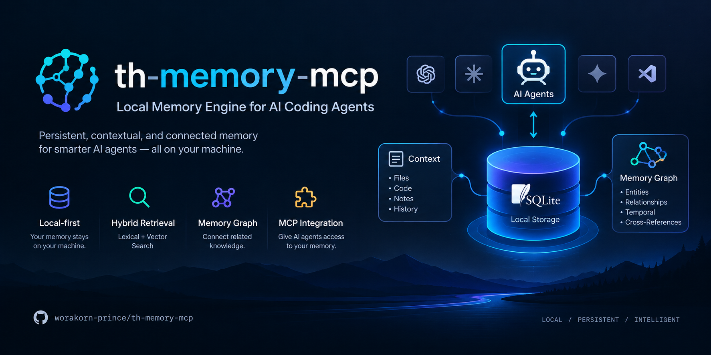

<div align="center">
  
</div>

# th-memory-mcp

<div align="center">

[](https://www.npmjs.com/package/th-memory-mcp) [](https://www.npmjs.com/package/th-memory-mcp) [](LICENSE) [](https://nodejs.org) [](https://github.com/worakorn-prince/th-memory-mcp/actions/workflows/ci.yml) [](https://github.com/worakorn-prince/th-memory-mcp/actions/workflows/version-sync.yml)

[](https://mcpservers.org/servers/worakorn-prince/th-memory-mcp) [](https://glama.ai/mcp/servers/worakorn-prince/th-memory-mcp) [](https://mcprush.com/to/th-memory-mcp?ref=badge) [](https://addonaudit.com/addon/io-github-worakorn-prince-th-memory-mcp/)

</div>

## Requirements

- **Node.js 22.23.4+, 24.22.1+, or 26.12.1+** — patched releases only; the server uses Node-only APIs (`better-sqlite3` native build, `import.meta.url`). Node.js 20 is EOL and unsupported. CI tests the minimum patched version of each supported line (22/24/26).
- **npm** — for `npm install`, `npm run build`, `npm test`. No external services, accounts, or API keys — everything lives in a single local SQLite file.
- **OpenCode** — the host that loads the MCP server and the auto-capture plugin (any build with MCP over stdio + plugins). The plugin uses `node:sqlite` on OpenCode Desktop/Node 22.5+ and falls back to `bun:sqlite` on the Bun-based CLI.
- **OS: Windows / macOS / Linux** — cross-platform (Node); Windows: set `MEMORY_DB_PATH` with `setx`, macOS/Linux: `export` in your shell profile.

> **Security:** Use a patched Node.js release — check your runtime with `npx is-my-node-vulnerable`. `npm audit` covers npm dependencies only, not Node.js core CVEs.

> **Audit:** Audited by [AddonAudit](https://addonaudit.com/addon/io-github-worakorn-prince-th-memory-mcp/) — v2.4.3 passed every published check with 0 advisories (critical/high/medium/low, audited 9 Nov 2026). This is an automated smoke test, not a security guarantee.

## Quick Start

**Fastest path:** `npm run quickstart` (after cloning) builds, wires `opencode.json`/`opencode.jsonc`, deploys the plugin, and sets `MEMORY_DB_PATH` — the steps below are the manual equivalent. **npm alternative:** `npm install -g th-memory-mcp` (or `npx th-memory-mcp`) and point `mcp.command` to `th-memory-mcp` instead of `dist/index.js` (plugin still from this repo; not on GitHub Packages anymore).

```bash
# 1. Clone and build
git clone https://github.com/worakorn-prince/th-memory-mcp.git
cd th-memory-mcp && npm install && npm run build
# 2. Share one DB between the server and the plugin
setx MEMORY_DB_PATH "$PWD/data/memory.db"      # Windows (PowerShell)
# export MEMORY_DB_PATH="$PWD/data/memory.db"  # macOS/Linux — add to your shell profile (~/.zshrc)
```

3. Merge this into `~/.config/opencode/opencode.json` (replace `<REPO>` with the absolute clone path; ready-made block in [`opencode.example.json`](opencode.example.json)). `MEMORY_DB_PATH` must be the SAME file for server and plugin — a system/user-level env var covers both; `environment` below covers the server only. Example rules: [`AGENTS.memory.example.md`](AGENTS.memory.example.md) (attachable at project level).

```json
{ "instructions": ["<REPO>/AGENTS.memory.example.md"],
  "mcp": { "memory": { "type": "local", "command": ["node", "<REPO>/dist/index.js"], "enabled": true, "environment": { "MEMORY_DB_PATH": "<REPO>/data/memory.db" } } } }
```

4. (Optional) Auto-capture: deploy the dual-mode plugin to a **directory** (OpenCode V2 only auto-discovers local plugins from a folder) — `src/plugin/learning-capture.ts` → `~/.config/opencode/plugins/learning-capture/index.ts`
5. **Restart OpenCode** (config loads at startup only), then try: *"Remember that I prefer pnpm"* → new session → *"What package manager do I prefer?"*

The plugin works in both modes: OpenCode V2 calls the default export's `id` + `setup(ctx)` (domain hooks for prompt/tool/compaction/failure events), while V1 (1.18.29+) calls the same default export's `server()`, which returns the legacy hook object. One file, no runtime import of `@opencode/plugin` (types only), so it loads under both Node and Bun.

If startup reports `Failed to load plugin ... Received protocol 'bun:'` or the plugin is silently ignored on V2, you are on an older install layout. Re-deploy the current `src/plugin/learning-capture.ts` to `~/.config/opencode/plugins/learning-capture/index.ts`; a legacy `~/.config/opencode/plugins/learning-capture.ts` is renamed to `.bak-<timestamp>` by `npm run quickstart` (never deleted). It loads `node:sqlite` first and only falls back to `bun:sqlite` under Bun.

## Architecture

OpenCode loads the plugin `learning-capture` (dual-mode V1/V2, Node/Bun) — auto-captures prompt/tool/error into the DB, injects the profile on compaction — and the MCP server `th-memory-mcp` (Node stdio) exposing the 16 tools on that same SQLite DB; global rules (`memory-protocol.md`) teach the AI to use them.

## Why th-memory-mcp?

- **Context-based learning, not fine-tuning** — captures your preferences, corrections, and habits, then recalls them next session; no data leaves your machine.
- **100% local & private** — one SQLite file, no cloud, no external API; secrets (`api_key=`, `password:`, `token`) filtered before storage.
- **Low overhead & resilient** — tool calls are capped (bounded output, low single-digit ms on typical databases) and degrade gracefully if the DB is unavailable; at 20,000 memories a full `retrieve` is ~90 ms — see [docs/PERFORMANCE.md](docs/PERFORMANCE.md).
- **Open & extensible** — MIT licensed; 16 documented tools, rule-based distill, auto-capture plugin; Node + `better-sqlite3` only (no extra native extensions).

## Performance

Measured with the internal benchmark harness at **20,000 memories / 5,000 queries** (same machine,
deterministic seed). Numbers are machine-specific; the deltas are not. Full method, per-step
breakdown and trade-offs: **[docs/PERFORMANCE.md](docs/PERFORMANCE.md)**.

| metric | 2.5.1 | 2.5.2 | Δ |
|---|---:|---:|---:|
| write throughput | 73.6 mem/s | **320.5 mem/s** (320–352 across runs) | **+335%** |
| `retrieve` (20k memories) | 363 ms | **90 ms** | −75% |
| `get_context` (20k memories) | 357 ms | **86 ms** | −76% |
| `recall` p95 | 3 ms | **1 ms** | −67% |
| retrieval quality (scope / supersession / MRR) | 100% / 100% / 0.955 | unchanged | — |

Two root causes were removed rather than tuned: FTS5 index writes did a full-table scan per record
(so writes were O(n) in database size), and every retrieval re-read and re-decoded all embedding
BLOBs. The retrieval cache is an **exact** contiguous scan — no ANN, no approximation — bounded by
`MEMORY_VECTOR_CACHE_MB` (default 64 MB, `0` disables it).

## Highlights

- **Structured memory** — preferences with confidence scoring plus `lesson` records (situation → mistake → correction), not just flat facts.
- **Lifecycle, temporal & conflict-aware** — states (active/stale/superseded/archived), confidence/importance/salience scoring, per-type decay, validity intervals for point-in-time truth and supersession chains; duplicate/contradiction resolution keeps both sides of ambiguous evidence.
- **Hybrid retrieval** — `get_context` blends FTS5 keyword search with dependency-free lexical fuzzy matching (hashed n-gram similarity, 512-dim FNV-1a) via RRF fusion, then assembles a token-budgeted context with optional memory-graph expansion.
- **Consolidation** — clusters similar memories into derived ones with full provenance (`derived_from` links).
- **First-class Thai / i18n** — Thai-aware FTS5: Thai text is word-segmented (`Intl.Segmenter`) and indexed with a mark-aware tokenizer, so words inside unspaced Thai text are searchable and tone marks stay significant (`ติดตัง` ≠ `ติดตั้ง`); a tone-tolerant `looseForm` channel, curated TH↔EN synonyms, and a personal Thai dict round it out — all reusable standalone via the zero-dep `thai-fts` CLI ([docs/thai-fts.md](docs/thai-fts.md)); Thai and English are accepted interchangeably.

## Works with other harnesses

A standard MCP server: 16 tools anywhere MCP-over-stdio works; all harnesses share one SQLite file via `MEMORY_DB_PATH`. Auto-capture needs a hook runtime (built into OpenCode, bridged for Claude Code).

| Feature | OpenCode | Claude Code | Qwen Code | Codex | Cursor | DeepSeek Harness (dsh) |
|---|---|---|---|---|---|---|
| 16 MCP tools | ✅ | ✅ | ✅ | ✅ | ✅ | ✅ `mcp__memory__*` |
| Auto-capture (background) | ✅ plugin | ✅ [hooks](CLAUDE_CODE_HOOKS.md) | ⚠️ adapter | ❌ manual | ❌ Rules | ❌ manual |
| Profile injection | ✅ compaction | ✅ UserPromptSubmit | ❌ `get_profile` | ❌ `get_profile` | ❌ `get_profile` | ❌ `get_context` |
| Lexical fuzzy matching | ✅ (v2.0) | ✅ (v2.0) | ✅ (v2.0) | ✅ (v2.0) | ✅ (v2.0) | ✅ (v2.0) |

- **Claude Code** ([CLAUDE_CODE_HOOKS.md](CLAUDE_CODE_HOOKS.md)) — drop-in hooks replace the plugin: capture + profile injection on `UserPromptSubmit`/`PreCompact`, distill on `SessionEnd`. **Qwen Code** ([QWEN_SETUP.md](QWEN_SETUP.md)) — MCP fully; hooks need a small Gemini-CLI adapter. **Codex** ([CODEX_SETUP.md](CODEX_SETUP.md)) · **Cursor** ([CURSOR_SETUP.md](CURSOR_SETUP.md)) — manual tools. **DeepSeek Harness** ([DSH_SETUP.md](DSH_SETUP.md)) — official MCP bridge (`@deepseek-ai/dsh-mcp-client`), tools exposed as `mcp__memory__*`; no auto-capture — rely on explicit `remember`/`recall` plus a short shared model instruction.

## Authentication (opt-in)

Default is **off** — v2.5.2 behaviour (caller-supplied `userId`, auto-created on first write). Set `MEMORY_AUTH=on` to require a server-verified identity at startup. Identity is read from the **process environment only**, never from tool arguments.

| Flag | Values | Default | Effect |
|---|---|---|---|
| `MEMORY_AUTH` | `off` \| `on` | `off` | `on` = resolve identity at startup and stop auto-creating users from caller ids; missing/invalid/revoked token exits the server with code 2 |
| `MEMORY_AUTH_TOKEN` | token (`thm_<userId>_<secret>`) | — | identity source (inline) |
| `MEMORY_AUTH_TOKEN_FILE` | path | — | identity source (file; 0600 recommended, trailing whitespace trimmed) |

```bash
th-memory auth add-user alice --name Alice --role writer   # admin CLI, MEMORY_AUTH not required
th-memory auth issue-token alice --label laptop            # prints the token ONCE — store it now
th-memory auth list                                        # labels + hash prefixes, never tokens
th-memory auth revoke <hash-prefix|label>                  # sets revoked_at
```

Tokens are stored **hash-only** (`sha256`) in `auth_tokens`; the plaintext is printed exactly once by `issue-token`. With `MEMORY_AUTH=on`, minting users is blocked on **all** production write paths — `create_memory` throws for an unknown `userId`, and `import_memory` skips payload users (an unknown row owner fails the whole import atomically) — so users/tokens are created via the admin CLI only. Ph-1 closes identity minting only — per-tool RBAC (Ph-2) and scope-ownership binding (Ph-3) complete the picture, so this is **not yet a full authorization boundary** (see [SECURITY.md](SECURITY.md)).

### Authorization (opt-in)

With `MEMORY_AUTH=on`, every tool call passes one role gate (`withAuth` in `src/auth/guard.ts`); with it off the gate is a pass-through and behaviour is unchanged. Roles are ranked and stored per user (`th-memory auth add-user <id> --role <role>`): `admin` ⊇ `owner` ⊇ `writer` ⊇ `reader`.

| Role | Tools allowed |
|---|---|
| `reader` | `recall`, `get_profile`, `get_context`, `memory_stats`, `search_history`, `get_recent_interactions` |
| `writer` | reader tools + `remember`, `save_lesson`, `update_memory`, `link_memory` |
| `owner` | writer tools + `forget`, `merge_memory`, `consolidate`, `export_memory`, `import_memory`, `extract_memories` |
| `admin` | all 16 (superset of `owner`; user/token admin is CLI-only, not an MCP tool) |

A call above the caller's role returns a normal bounded tool error — `error: denied: <tool> requires role <minRole> (auth enforced)` with `isError: true`. The handler never runs, so a denied call changes nothing; the caller's own roles are not echoed, and one bounded (redacted, 240-char) line is written to stderr. A tool with no policy entry cannot register at all (server boot fails), so a new tool cannot slip in unpoliced.

Roles gate **tools, not data**: scope-ownership binding (caller `userId` vs the authenticated identity, project/session membership, grants) is Phase 3. Interim gap: `search_history` and `get_recent_interactions` read interactions, which are shared/unscoped today, so any authenticated role can read them until Phase 3 adds `interactions.user_id`.

## Scripts

| Command | Description |
|---------|-------------|
| `npm run build` | compile TypeScript → `dist/` |
| `npm start` | run the MCP server (stdio) from `dist/index.js` |
| `npm run distill` | interactions → profile sections + prune old data (`RETENTION_DAYS`, default 30) |
| `npm test` | build + full suite (61 files, 310 tests: 309 pass, 1 skip; the `smoke.mjs` tool-latency budget can flake on a loaded machine — use `SMOKE_MAX_TOOL_MS=200` or `--test-concurrency=1`) |
| `node test/<name>.test.mjs` | run one suite: `capture`, `distill`, `lifecycle`, `temporal`, `conflict`, `retrieval`, `graph`, `context`, `consolidation`, `benchmark`, `security`, `thai_fts` |
| `node test/smoke.mjs` | end-to-end smoke test over JSON-RPC (16 tools) |

## Tools (16)

| Tool | Description |
|------|-------------|
| `remember` | upsert preference (category+key); re-save +0.1 confidence (cap 1.0) |
| `recall` | search preferences + lessons (FTS5) + recent matching interactions — run before a new task |
| `get_profile` | profile sections + top preferences + 5 most recent lessons |
| `save_lesson` | record a lesson from a correction (situation / mistake / correction) |
| `search_history` | search past prompts by keyword (200-char snippets) |
| `forget` | delete one row (preference/lesson/interaction) by id (+type avoids cross-table id clash) |
| `memory_stats` | counts by kind, DB size, oldest/newest interaction, profile sections |
| `get_recent_interactions` | recent raw interactions (filter by kind) — Smart Distill feedstock |
| `export_memory` | export to JSON under `data/exports/` only (filename auto-sanitized) |
| `get_context` | task-relevant memories via hybrid retrieval (+ graph expansion), token-budgeted |
| `consolidate` | cluster similar memories via embedding similarity; optionally create derived memories linked via `derived_from` |
| `link_memory` | typed link between two memories: supports/contradicts/supersedes/derived_from/related_to/caused_by/depends_on |
| `merge_memory` | merge a duplicate into canonical memory (source superseded; provenance in `metadata.merged_from`) |
| `update_memory` | update fields in place, or create a superseding memory when `content` changes (`supersede=false` edits in place) |
| `import_memory` | import from JSON (validates type, dedupes, never overwrites blindly); dry-run by default, `apply=true` to insert |
| `extract_memories` | scan recent interactions for memory-intent phrases, propose candidates (deterministic, no LLM); dry-run by default, `apply=true` to create (source=captured) |

## CLI (`th-memory`)

| Binary | Entry | Purpose |
|--------|-------|---------|
| `th-memory-mcp` | `dist/index.js` | MCP server (stdio) — the 16 tools above |
| `th-memory` | `dist/cli.js` | zero-dep local CLI (same DB via `MEMORY_DB_PATH`) |

Usage: `th-memory [--db <path>] [--json] [--plain] <command> [options]` — per-command help via `th-memory <command> --help`. `highlight`/`recall --highlight`: matches underlined (`ESC[4m`) on a color TTY, else `[mem]`…`[/mem]` markers (piped, `--plain`, `--json`).

| Flag | Effect |
|------|--------|
| `--db <path>` | use this SQLite file (sets `MEMORY_DB_PATH`) |
| `--json` | print JSON `{ok,data}` instead of plain text |
| `--plain` / `--no-color` | disable colors |
| `-h, --help` / `-V, --version` | show help / print version |

| Command | Usage |
|---------|-------|
| `remember` | `remember --category <c> --key <k> --value <v\|->` — save a preference (`--value -` reads from stdin) |
| `recall` | `recall <topic> [--limit <n>] [--highlight]` — search memory |
| `forget` | `forget <id> [--type <t>]` — delete by id (`t`: `memory\|preference\|lesson\|interaction`) |
| `export` | `export [--include-interactions] [--filename <n>]` — export to `data/exports/*.json` |
| `import` | `import (--file <p>\|--json <s>) [--apply] [--user-id <id>]` — import backup (dry-run by default) |
| `stats` | `stats` — memory statistics |
| `profile` | `profile` — distilled user profile |
| `history` | `history [--query <q>] [--limit <n>]` — search past prompts (no query = recent prompts) |
| `recent` | `recent [--limit <n>] [--kind <k>]` — recent interactions (`k`: `prompt\|tool_call\|error`) |
| `highlight` | `highlight [text...] -q <topic> [--limit <n>]` — highlight topic matches (empty text = stdin pipe) |
| `auth` | `auth <add-user\|issue-token\|list\|revoke\|backfill-interactions> [opts]` — opt-in identity/token admin (see below) |
| `grant` | `grant <add\|remove\|list> --user <id> --kind USER|PROJECT|SESSION|GLOBAL --ref <target> --permission read\|write` — scope grants admin (see below) |

```bash
th-memory remember --category coding_pref --key package_manager --value pnpm
th-memory recall pnpm --limit 5
echo "I prefer pnpm for installs" | th-memory highlight -q pnpm

# Scope grants (Phase 3, opt-in, requires MEMORY_AUTH=on)
th-memory grant add --user alice --kind USER --ref bob --permission read
th-memory grant list --user alice
```

## Daily usage

The AI accepts Thai and English interchangeably; long-term care: `npm run distill` summarizes stats and prunes interactions older than 30 days.

- "Remember that..." → `remember` — save a preference
- "Summarize memory" / "distill memory" → **Smart Distill** — AI reads `get_recent_interactions`, finds patterns, saves insights itself
- "How is my memory?" / "memory status" → `memory_stats`
- "Export memory" / "backup memory" → `export_memory`
- "Search history..." → `search_history` · "Forget..." → `forget`

## data/ structure

```
data/
├── memory.db          # SQLite (WAL mode) — main DB (+ .db-wal, .db-shm); path overridable via MEMORY_DB_PATH
└── exports/           # JSON files from export_memory (writeable only in this dir)
# everything in data/ is git-ignored
```

## Scope Isolation (Phase 3, opt-in, requires `MEMORY_AUTH=on`)

With `MEMORY_AUTH=on`, every tool's scope is derived **from the verified identity**, never from raw arguments:

- **Ownership**: writes (preferences, lessons, memories) go to the caller's own USER scope by default. Writing another user's scope requires an explicit grant.
- **Grants**: `th-memory grant add --user <id> --kind USER|PROJECT|SESSION|GLOBAL --ref <target> --permission read|write` allows cross-scope access. Grants are non-escalatable: read never implies write.
- **Read filtering**: `recall`, `get_profile`, `search_history`, `get_recent_interactions`, `memory_stats`, `export_memory` only return rows the identity may see (own USER + GLOBAL, plus granted scopes; anonymous interactions visible to owner/admin only).
- **Capture attribution**: optional `MEMORY_CAPTURE_USER=<external_id>` (read by the plugin/capture core) tags new interaction rows; unknown id → NULL (never mints a user). NULL interactions are owner/admin-only in enforcement.
- **Audit**: every enforced decision (allow + deny) is recorded in `audit_log` with bounded, content-free fields (`tool`, `kind`, `decision`, `reason`, `scope_kind`, `scope_ref`). Legacy mode writes no audit rows.

See `SECURITY.md` for the full threat model, role matrix, and grant semantics.

## Encryption at Rest (Phase 4, opt-in, requires `MEMORY_ENCRYPTION=on`)

With `MEMORY_ENCRYPTION=on` and `MEMORY_ENCRYPTION_KEY` set (base64-encoded 32 bytes), the entire database file — including WAL and SHM files — is encrypted via SQLCipher (via `better-sqlite3-multiple-ciphers`):

- **One-time migration**: existing plaintext DB is automatically migrated on first startup (`copy + PRAGMA rekey` via manual schema+data copy; `sqlcipher_export` not used). Migration is idempotent and atomic (temp file + rename).
- **All data encrypted**: main DB, WAL, SHM, FTS5 indexes, vector embeddings — everything.
- **Backup**: `th-memory export --include-interactions` produces encrypted backup via `VACUUM INTO`; restore by replacing file + same key.
- **Key management**: `MEMORY_ENCRYPTION_KEY` (base64, 32 bytes) required when enabled; fail-fast if missing/invalid. Optional `MEMORY_ENCRYPTION_KDF_ITER` (default 256000) for KDF iterations.
- **Cipher**: AES-256-CBC (SQLCipher default), page size 4096.
- **Default (off)**: byte-identical to Ph-3 — plaintext DB, no encryption overhead, no native build dependency if `better-sqlite3` already installed.

```bash
# Generate a key
openssl rand -base64 32

# Enable encryption
export MEMORY_ENCRYPTION=on
export MEMORY_ENCRYPTION_KEY="<your-base64-key>"
th-memory-mcp  # or th-memory <command>
```

## Known Limitations

- **Encryption is application-layer** — a local user with filesystem access to `data/memory.db` AND the encryption key (in env/process memory) can decrypt. For defense-in-depth: OS full-disk encryption (BitLocker / FileVault / LUKS) + restrict key access.
- **Key in process memory** — the decoded key resides in process memory; OS-level protections (no swap, locked memory) recommended for high-security environments.
- **No key rotation** — changing the key requires full re-encryption (dump → re-encrypt → restore). Not supported in Ph-4.
- **No HSM/TPM integration** — key stored in env var; Ph-5 may add OS keyring integration.
- **Backup is encrypted with same key** — if key is compromised, all backups are compromised.
- **Not a full boundary until OS-level isolation** — scope isolation + encryption is application-layer; OS-level DB file access bypasses app-level checks.

## License

[MIT](LICENSE) © 2026 worakorn-prince — see [LICENSE](LICENSE) for the full text.
