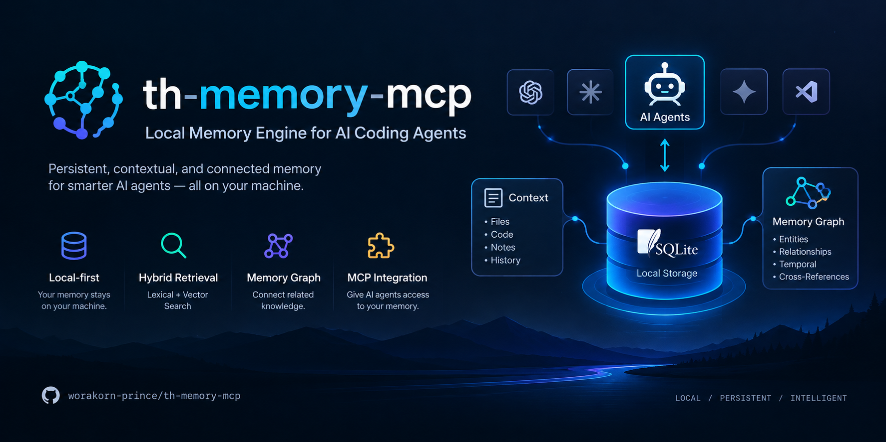

[](https://www.npmjs.com/package/th-memory-mcp) [](https://www.npmjs.com/package/th-memory-mcp) [](LICENSE) [](https://nodejs.org) [](https://github.com/worakorn-prince/th-memory-mcp/actions/workflows/ci.yml)

[](https://mcpservers.org/servers/worakorn-prince/th-memory-mcp) [](https://glama.ai/mcp/servers/worakorn-prince/th-memory-mcp) [](https://mcprush.com/to/th-memory-mcp?ref=badge) [](https://addonaudit.com/addon/io-github-worakorn-prince-th-memory-mcp/)

# th-memory-mcp

**ความจำถาวรสำหรับ AI coding agent ผ่าน MCP — เก็บในเครื่องคุณคนเดียว.**
ฐานข้อมูล SQLite ไฟล์เดียวจำ preference, lesson, decision และบริบทของโปรเจกต์ แล้วส่งข้อมูลที่เกี่ยวข้อง
กลับให้ agent ก่อนเริ่มงาน. ค้นหาแบบ hybrid (FTS5 + vector ท้องถิ่น), รองรับไทย/อังกฤษ, ไม่ใช้ cloud และไม่ต้องใช้ API key.

## ได้อะไรจากโปรเจกต์นี้

| | |
|---|---|
| 🧠 **16 MCP tools** | `remember`, `recall`, `get_context`, `get_profile`, `save_lesson`, `consolidate`, `link_memory`, `merge_memory`, `update_memory`, `forget`, `search_history`, `get_recent_interactions`, `memory_stats`, `export_memory`, `import_memory`, `extract_memories` |
| 🔎 **ค้นหาแบบ hybrid** | FTS5 (ตัดคำไทย, ทนวรรณยุกต์ผิด) ผสานกับ vector 512 มิติด้วย RRF แล้วจัดอันดับใหม่ด้วย confidence/importance/recency/scope |
| 🕰 **เข้าใจเวลาและความขัดแย้ง** | ช่วงความถูกต้อง (validity), supersession, แยก duplicate/contradiction — ข้อมูลที่กำกวมถูกเก็บไว้ ไม่ลบเงียบ ๆ |
| 🔌 **ใช้ได้กับหลาย harness** | plugin OpenCode (capture อัตโนมัติ), Claude Code hooks, Codex, Cursor, Qwen Code, DeepSeek Harness ผ่าน MCP |
| 🔐 **ความปลอดภัยแบบ opt-in** | RBAC ทุกเครื่องมือ, แยกขอบเขตตาม identity พร้อม grant, `audit_log` ที่ไม่เก็บเนื้อหา, เข้ารหัสทั้ง DB ด้วย SQLCipher พร้อม rotate/backup/drill |
| 📴 **ออฟไลน์โดยค่าเริ่มต้น** | ไม่เรียกเครือข่าย ไม่มีบัญชี ไม่ต้องใช้ API key — ข้อมูลอยู่ในไฟล์เดียวในเครื่อง |

## Performance

วัดด้วย harness ภายในบนเครื่องเดียวกัน ใช้ seed 42; profile normal = 20,000 memories / 5,000 queries แต่ละช่องแสดง 3 รอบล่าสุด เรียงจากเก่าไปใหม่

| metric | 2.5.1 | 3.0.0 | 3.0.1 |
|---|---:|---:|---:|
| insert throughput (mem/s) | 352.6 / 331.9 / 320.5 | 331.7 / 277.4 / 361.5 | 348.0 / 337.4 / 352.9 |
| `retrieve` @20k (ms) | 103.9 / 106.2 / 90.3 | 75.8 / 87.2 / 82.2 | 76.7 / 74.4 / 73.5 |
| `get_context` @20k (ms) | 102.5 / 116.5 / 86.2 | 70.3 / 70.7 / 80.5 | 70.5 / 68.5 / 69.5 |
| `recall` p95 (ms) | 1.00 / 2.00 / 1.00 | 1.00 / 2.00 / 1.00 | 2.00 / 2.00 / 1.00 |
| DB size (MB) | 101.1 / 101.1 / 101.1 | 101.1 / 101.3 / 100.7 | 100.7 / 100.7 / 100.7 |

ข้อสังเกต: v3.0.x ใช้เวลา `retrieve` / `get_context` ~68–87 ms เทียบกับ ~86–116 ms ของ 2.5.1 และมี peak RSS สูงขึ้น (quick ~262–306 MB เทียบกับ ~110–199 MB; normal ~432 MB เทียบกับ ~113–203 MB) โมดูล auth/encryption และ native `better-sqlite3-multiple-ciphers` ตรงกับช่วงที่ memory เพิ่มขึ้น แต่ยังไม่ได้วัดแยกว่าส่วนใดกินเท่าไร

[ประวัติประสิทธิภาพทั้งหมด ตาราง 3 รอบต่อ version และ quality gates → `docs/PERFORMANCE.md`](docs/PERFORMANCE.md)

## ติดตั้งใน 60 วินาที

```bash
git clone https://github.com/worakorn-prince/th-memory-mcp.git
cd th-memory-mcp && npm install && npm run build

# ใช้ DB ไฟล์เดียวร่วมกันระหว่าง server และ plugin
setx MEMORY_DB_PATH "%CD%\data\memory.db"          # Windows
# export MEMORY_DB_PATH="$PWD/data/memory.db"      # macOS/Linux (ใส่ใน shell profile)
```

จากนั้นลงทะเบียน MCP server ด้วยบล็อกสำเร็จรูปที่
[`setup/opencode.example.json`](setup/opencode.example.json) (หรือรัน `npm run quickstart`)
กฎความจำตัวอย่าง: [`setup/AGENTS.memory.example.md`](setup/AGENTS.memory.example.md)

## เอกสาร

| หัวข้อ | ที่ไหน |
|---|---|
| **เอกสารฉบับเต็ม** — ความต้องการระบบ, สถาปัตยกรรม, เครื่องมือทุกตัว, CLI, การใช้งานประจำวัน | [`docs/Docs.th.md`](docs/Docs.th.md) |
| Full documentation (English) | [`docs/Docs.md`](docs/Docs.md) |
| การยืนยันตัวตน, RBAC และการแยกขอบเขตข้อมูล | [docs/Docs.th.md § ความปลอดภัย](docs/Docs.th.md#ความปลอดภัย-opt-in) |
| เข้ารหัสฐานข้อมูล, rotate key, backup / verify / restore / drill | [docs/Docs.th.md § การเข้ารหัส](docs/Docs.th.md#การเข้ารหัสฐานข้อมูล-encryption-at-rest-opt-in) |
| Threat model และความเสี่ยงที่เหลือ | [`SECURITY.md`](SECURITY.md) |
| อัปเกรดจาก 2.x | [`MIGRATION_v3.md`](MIGRATION_v3.md) |
| ผลวัดประสิทธิภาพ | [`docs/PERFORMANCE.md`](docs/PERFORMANCE.md) |
| รายละเอียด Thai search (ใช้ซ้ำได้) | [`docs/thai-fts.md`](docs/thai-fts.md) |
| ประวัติการเปลี่ยนแปลง | [`CHANGELOG.md`](CHANGELOG.md) |

## ตั้งค่าตามเครื่องมือ

| เครื่องมือ | คู่มือ |
|---|---|
| OpenCode | [`setup/opencode.example.json`](setup/opencode.example.json) + `npm run quickstart` |
| Claude Code | [`setup/CLAUDE_CODE_HOOKS.md`](setup/CLAUDE_CODE_HOOKS.md) |
| Codex | [`setup/CODEX_SETUP.md`](setup/CODEX_SETUP.md) |
| Cursor | [`setup/CURSOR_SETUP.md`](setup/CURSOR_SETUP.md) |
| Qwen Code | [`setup/QWEN_SETUP.md`](setup/QWEN_SETUP.md) |
| DeepSeek Harness | [`setup/DSH_SETUP.md`](setup/DSH_SETUP.md) |

## ความปลอดภัยในย่อหน้าเดียว

ถ้าไม่ตั้ง environment variable ใด ๆ เซิร์ฟเวอร์ทำงานเหมือน 2.5.x ทุกประการ: ไม่มี auth, DB เป็น plaintext,
ไม่มี I/O เพิ่ม. ความปลอดภัยเป็น opt-in และแยกจากกัน: `MEMORY_AUTH=on` เพิ่ม identity ที่ตรวจสอบได้,
role gate เดียวครอบทั้ง 16 tools, การแยกขอบเขตตาม identity พร้อม grant ที่ชัดเจน และ `audit_log`;
`MEMORY_ENCRYPTION=on` เข้ารหัสทั้งฐานข้อมูล (SQLCipher ผ่าน `better-sqlite3-multiple-ciphers`)
พร้อม `db rekey`, `db verify-backup`, `db restore`, `db drill`.
รายละเอียดและความเสี่ยงที่เหลือ: [`SECURITY.md`](SECURITY.md)

## License

[MIT](LICENSE) © 2026 worakorn-prince
